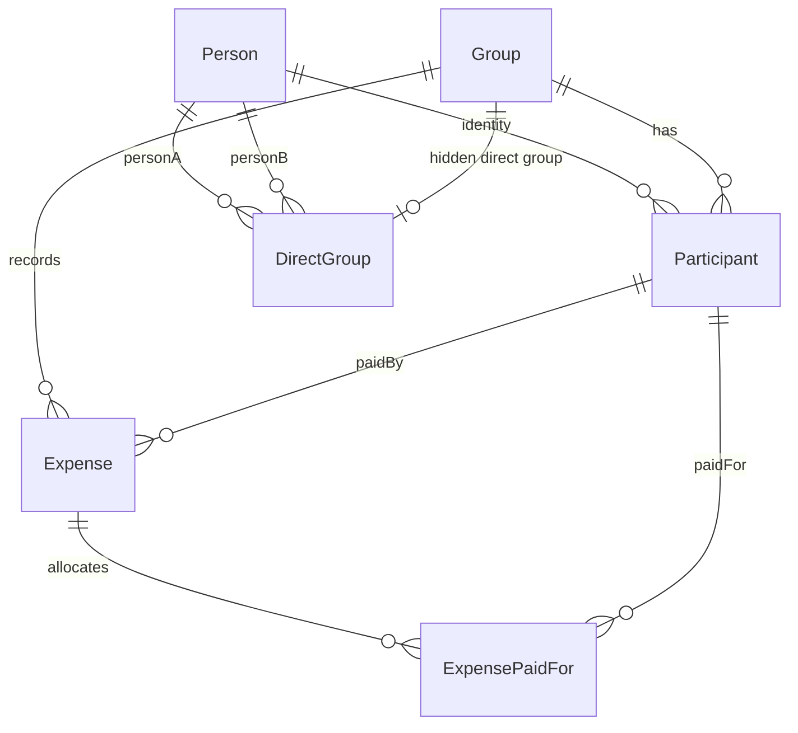
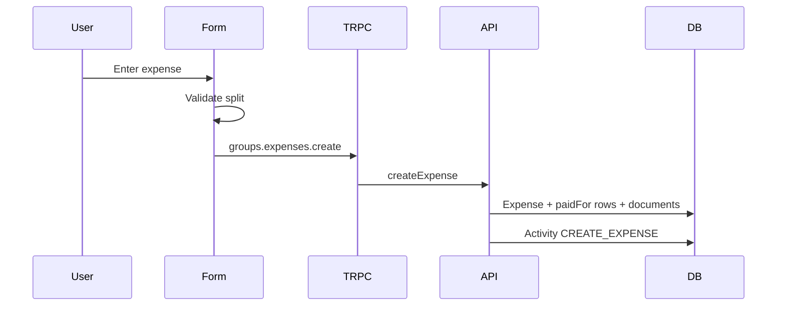
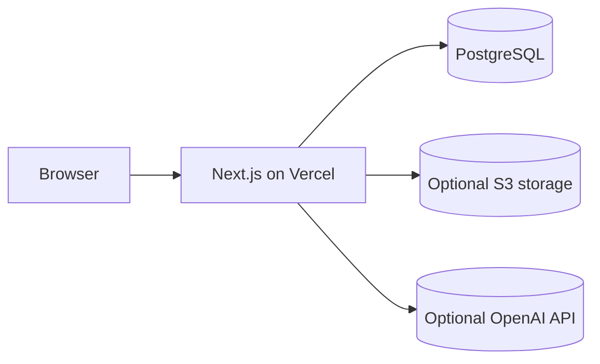

# LEDGER Architecture

## Frontend Structure

```mermaid
flowchart TD
  Layout[src/app/layout.tsx] --> Shell[AppShell]
  Shell --> Overview[src/app/page.tsx]
  Shell --> Friends[src/app/friends]
  Shell --> FriendDetail[src/app/friends/[friendKey]]
  Shell --> Groups[src/app/groups]
  Shell --> GroupDetail[src/app/groups/[groupId]]
  Shell --> Activity[src/app/activity]
  Shell --> Settings[src/app/settings]
```

The app uses Next.js App Router. Server components remain in place for routing
and metadata; client components handle local storage, tRPC hooks, forms,
navigation state, and interactive payment/identity flows.

## Product Shell

Desktop uses a fixed left rail with LEDGER branding, Overview, Friends, Groups,
Activity, New expense, My identity, and Settings. Mobile uses a compact header
and safe-area-aware bottom navigation with a prominent center New expense
action.

## Server And API Structure

```mermaid
flowchart TD
  Client[tRPC React client] --> API[/api/trpc]
  API --> GroupsRouter[groups router]
  API --> PersonalRouter[personal router]
  GroupsRouter --> ExistingAPI[src/lib/api.ts]
  PersonalRouter --> Ledger[src/lib/splitmate/personal-ledger.ts]
  ExistingAPI --> Prisma[(Prisma)]
  Ledger --> Balances[src/lib/balances.ts]
  Ledger --> Shares[src/lib/shares.ts]
```

Existing group, expense, balance, stats, category, document, and activity routes
remain in use. LEDGER adds personal routes for Overview aggregation, identity
linking, direct group creation, person details, and explicit settlements.

## Database Models

Core models:

- `Group`
- `Person`
- `Participant`
- `DirectGroup`
- `Expense`
- `ExpensePaidFor`
- `ExpenseDocument`
- `Activity`
- `Category`
- `RecurringExpenseLink`



`Person` is the stable cross-group human identity. `Participant` remains the
group-scoped accounting actor. Expenses still reference participants, so linking
or unlinking a person changes personal aggregation without rewriting financial
records.

## Expense Lifecycle



Amounts are stored as integer minor units. Split validation and rounding remain
in the existing engine.

## Balance Calculation

`getExpenseShares` calculates whole-minor-unit shares that sum exactly to the
expense amount. `getBalances` computes paid, paid-for, and net totals. Suggested
reimbursements are produced by `getSuggestedReimbursements`.

LEDGER Overview and Friends call those helpers through
`buildPersonalDashboard`. Cross-group friend aggregation uses `Person.id` only.
Display names are never financial identity keys.

## Direct Friend Expenses

Friends -> Friend detail -> Add expense creates or reuses one hidden
`DirectGroup` for the unordered pair of `Person` IDs. The visible form stays
friend-focused, but the saved expense is a normal group expense with normal split
rows.

## Settlement Lifecycle

Settlements are reimbursement expenses:

- `paidBy` is the person paying back;
- `paidFor` contains the recipient;
- amount is the settlement amount;
- UPI settlements include method/note context.

UPI launch and QR display never create a reimbursement. Only explicit
`Mark as settled` confirmation records settlement.

## Receipt And AI Flow

Receipt uploads reuse the existing S3-compatible document flow. AI receipt and
category extraction stay server-side, require optional environment variables,
and populate drafts/suggestions only.

## Group Access Model

Groups are capability links. Recent group IDs and active-user choices live in
browser local storage. Server mutations that link identities or create direct
groups verify that the referenced people/participants are connected to groups
the browser can access.

## Identity Model

Browser profile settings live under `ledger.identity`. Older
`splitmate.identity` values are read for migration. Database identity lives in
`Person` and `Participant.personId`; it is intentionally separate from
authentication.

## Currency Handling

Group expenses use the group's currency. Overview/Friend totals are bucketed by
currency code or custom symbol. LEDGER never sums different currencies without a
persisted conversion rate.

## Deployment



Deploy schema changes with `prisma migrate deploy`. Never reset a production
database.
