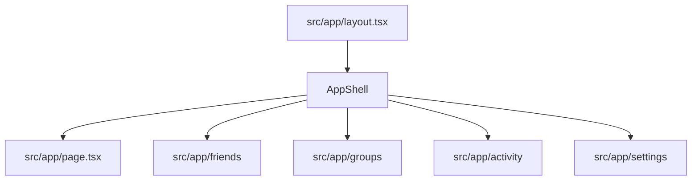
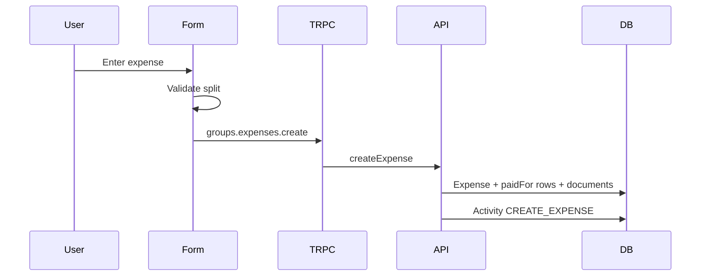
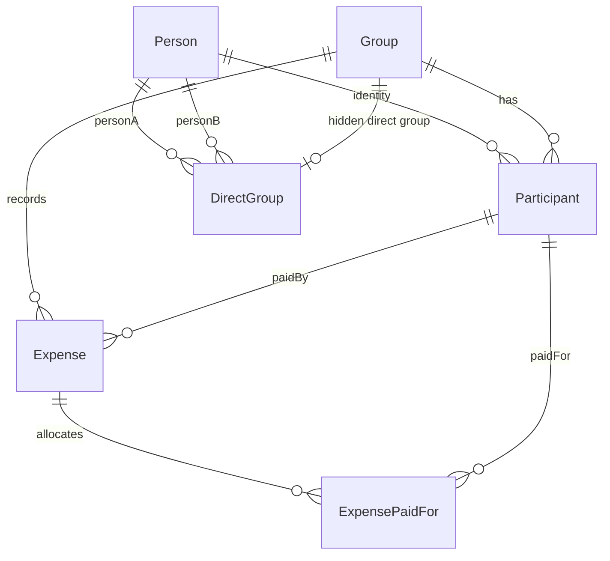
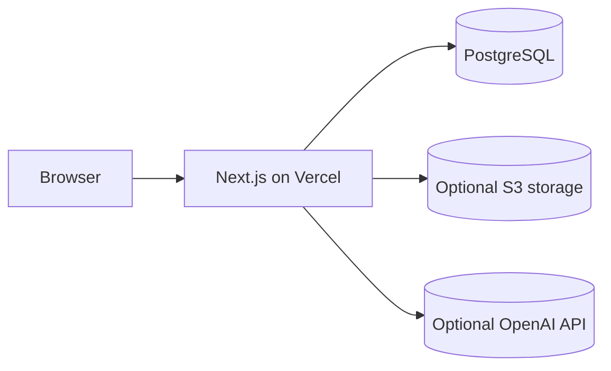

# SplitMate Architecture

## Frontend Structure



The app uses Next.js App Router. Server components are kept where possible, and
client components are used for local storage, tRPC hooks, forms, and interactive
navigation.

## Server And API Structure

```mermaid
flowchart TD
  Client[tRPC React client] --> API[/api/trpc]
  API --> GroupsRouter[groups router]
  API --> PersonalRouter[personal router]
  GroupsRouter --> ExistingAPI[src/lib/api.ts]
  PersonalRouter --> Prisma[Prisma]
  PersonalRouter --> Ledger[personal-ledger.ts]
```

The existing groups, expenses, balances, stats, categories, and activities
routers remain in place. SplitMate adds personal routes for dashboard data,
stable identity linking, direct friend groups, and explicit settlement creation.

## Database Models

Prisma models are defined in `prisma/schema.prisma`.

Core lifecycle models:

- `Group`
- `Person`
- `Participant`
- `Expense`
- `ExpensePaidFor`
- `ExpenseDocument`
- `Activity`
- `Category`
- `RecurringExpenseLink`
- `DirectGroup`

`Person` is the stable cross-group identity. `Participant` remains the
group-scoped accounting actor, and each participant can point to one `Person`
through nullable `personId`. Financial records still reference participants, so
linking identities never rewrites historical expenses.

`DirectGroup` maps one unordered pair of `Person` IDs to one hidden two-person
group. Direct friend expenses and UPI settlements use that group while keeping
the normal expense and reimbursement engine.

## Expense Lifecycle



Amounts are stored as integer minor units. Split modes are validated by
`expenseFormSchema`.

## Balance Calculation

`getExpenseShares` calculates whole-minor-unit shares that sum exactly to the
expense amount. `getBalances` computes paid, paid-for, and net totals. Suggested
reimbursements are produced by `getSuggestedReimbursements`.

SplitMate personal aggregation calls those existing helpers. Friend aggregation
uses `Person.id` as the only cross-group identity key. Display names are used
only for display/search; they are never authoritative financial keys. If a
legacy participant has no `personId`, the ledger falls back to a key scoped to
that one participant in that one group.

## Settlement Lifecycle

A settlement is represented as an expense with `isReimbursement=true`:

- `paidBy` is the person paying back;
- `paidFor` contains the recipient;
- amount is the settlement amount.

This reduces balances through the same engine as normal expenses.

UPI settlements are created only after explicit user confirmation. Opening a UPI
URI or displaying/scanning a QR code does not create a reimbursement.

## Receipt Flow

Receipt attachments use the existing document upload UI and S3-compatible API.
When receipt extraction is enabled, the server calls OpenAI and returns a draft
for the user to review before saving.

## AI Flow

AI features are server-side only:

- receipt extraction;
- category suggestion.

They require `OPENAI_API_KEY` and relevant feature flags. Missing AI
configuration disables enhancement, not manual entry.

## Group Access Model

Groups are accessed by URL capability. Recent groups and active users are stored
in browser local storage. Group IDs should be treated as sensitive links.
Identity-link mutations require the caller to provide accessible group IDs from
local storage, and the server verifies that edited participants/people are linked
to those groups.

## Identity Model

SplitMate profile settings are stored locally under `splitmate.identity`.
Database identity is handled separately with `Person` and `Participant.personId`.
The local profile does not create authentication; it helps personalize this
browser and identify the current user in known groups.



## Currency Handling

Group expenses use the group's currency. Dashboard totals are bucketed by
currency code or custom symbol. Different currencies are displayed separately.

## Deployment Architecture



Prisma migrations are deployed with `prisma migrate deploy`. Never reset a real
database.
